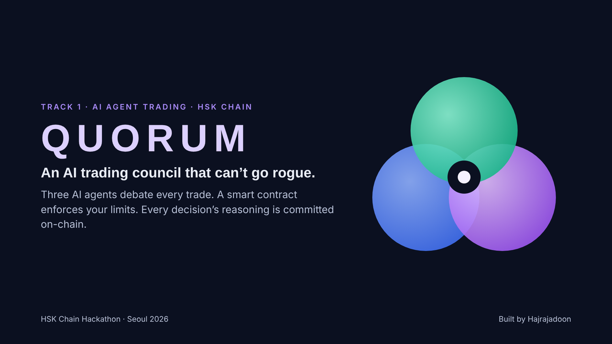
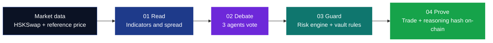
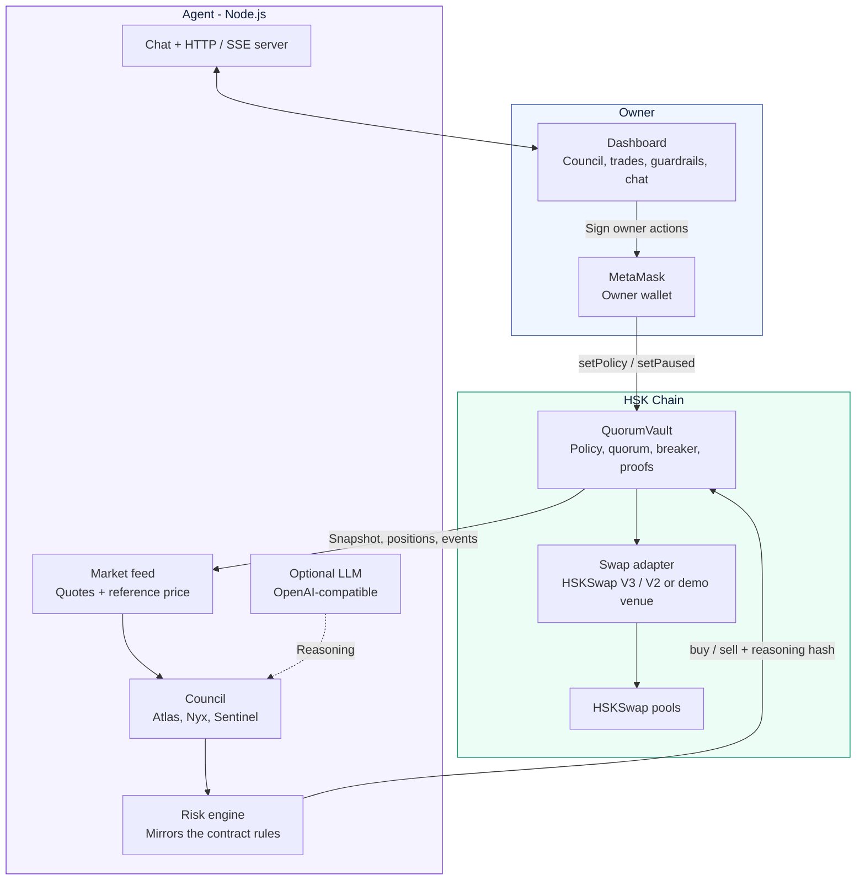
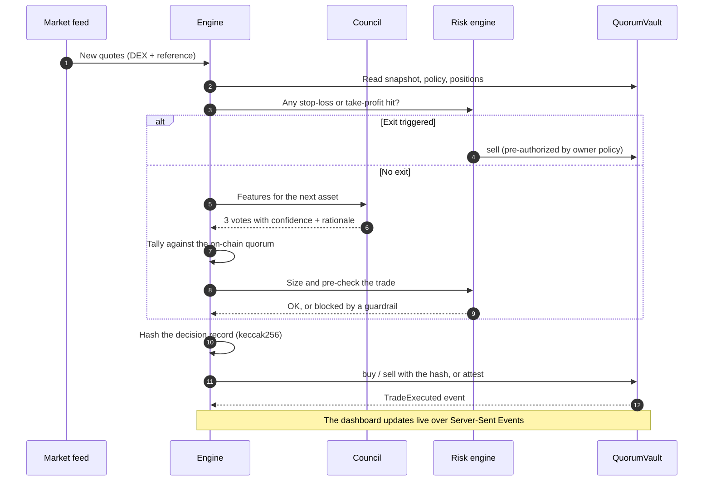
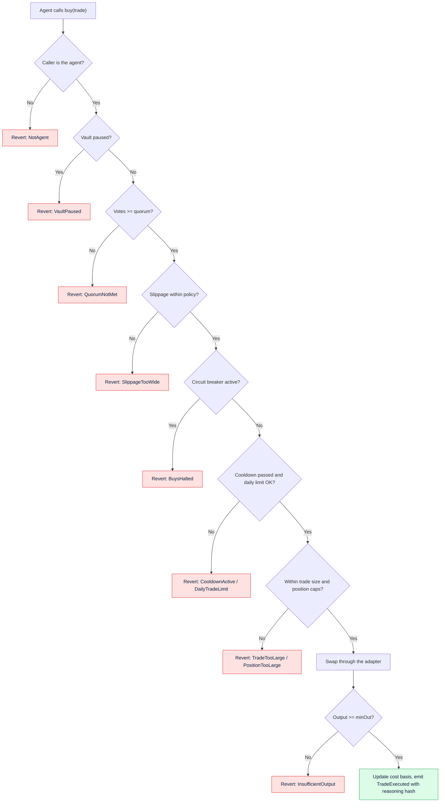
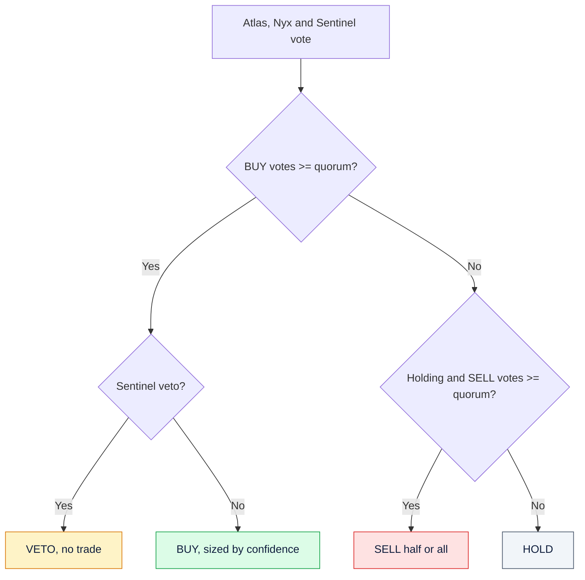
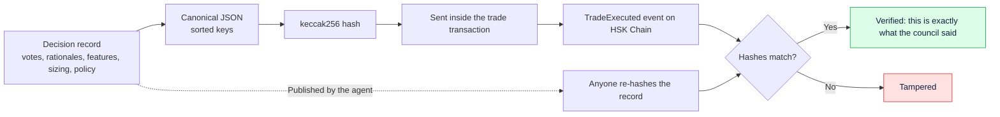
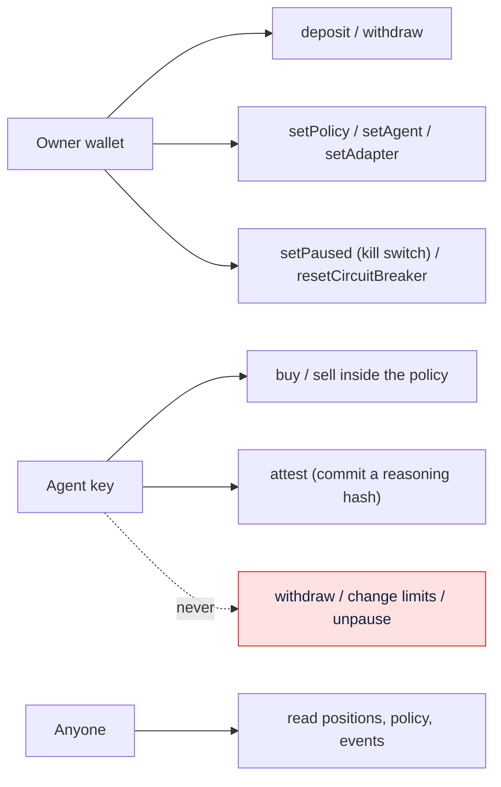

<div align="center">


<br />

### An AI trading council that can't go rogue.

**Three AI agents debate every trade. A smart contract enforces your risk limits. Every decision's reasoning is committed on-chain.**

<br />

[](https://hajrajadoon.github.io/quorum-hsk/)
[](https://hajrajadoon.github.io/quorum-hsk/demo.html)
[](https://youtu.be/4Ng4FJzmM2I)
[](https://hajrajadoon.github.io/quorum-hsk/QUORUM-pitch-deck.pdf)


<br />

**[Website](https://hajrajadoon.github.io/quorum-hsk/)** · **[Live Demo](https://hajrajadoon.github.io/quorum-hsk/demo.html)** · **[Pitch Deck](https://hajrajadoon.github.io/quorum-hsk/QUORUM-pitch-deck.pdf)** · **[Getting Started](#getting-started)** · **[Deploy to Mainnet](docs/DEPLOY.md)**

</div>

---

## Table of Contents

- [Overview](#overview)
- [Pitch Deck](#pitch-deck)
- [Live Deployment](#live-deployment)
- [The Problem and Our Solution](#the-problem-and-our-solution)
- [Key Features](#key-features)
- [How QUORUM Works](#how-quorum-works)
- [Meet the Council](#meet-the-council)
- [System Architecture](#system-architecture)
- [Workflow Diagrams](#workflow-diagrams)
  - [Decision Cycle](#decision-cycle)
  - [Trade Execution Flow](#trade-execution-flow)
  - [Council Voting Logic](#council-voting-logic)
  - [Proof of Reasoning](#proof-of-reasoning)
  - [Who Can Do What](#who-can-do-what)
- [Smart Contracts](#smart-contracts)
- [On-chain Risk Policy](#on-chain-risk-policy)
- [Chat Commands](#chat-commands)
- [Tech Stack](#tech-stack)
- [Project Structure](#project-structure)
- [Getting Started](#getting-started)
  - [Prerequisites](#prerequisites)
  - [Run the Demo](#run-the-demo)
  - [Build and Test the Contracts](#build-and-test-the-contracts)
  - [Run Live on HSK Chain](#run-live-on-hsk-chain)
  - [Environment Variables](#environment-variables)
- [Using the Dashboard](#using-the-dashboard)
- [Agent API](#agent-api)
- [Hosting the Website](#hosting-the-website)
- [Security Model](#security-model)
- [Limitations](#limitations)
- [Roadmap](#roadmap)
- [Disclaimer](#disclaimer)
- [Contributing](#contributing)
- [License](#license)
- [Author](#author)

---

## Overview

AI trading agents have a trust problem. To use one, you hand an AI your private key and hope. One hallucination, one prompt injection or one leaked server key is enough to drain the account.

**QUORUM** is an autonomous trading agent for **HSKSwap on HSK Chain** built around three layers of trust:

1. **No single AI decides.** Three agents with different mandates debate every trade. A trade needs a **quorum** (2 of 3 by default), and the risk officer can **veto**.
2. **A contract enforces the limits.** Funds live in `QuorumVault`. The agent key can trade **only inside the owner's risk policy** and **can never withdraw**.
3. **Every decision is provable.** The full reasoning behind each decision is hashed with keccak256 and committed **on-chain** inside the trade transaction. Anyone can re-hash it and verify it.

Users control everything in plain language: *"be more conservative"*, *"stop loss 2%"*, *"only trade HSK"*, *"why did you sell?"*, *"close all"*.

> QUORUM · AI that can be audited.

---

## Pitch Deck

<a href="https://hajrajadoon.github.io/quorum-hsk/QUORUM-pitch-deck.pdf"></a>

**[Open the pitch deck (PDF)](https://hajrajadoon.github.io/quorum-hsk/QUORUM-pitch-deck.pdf)**: problem, solution, the council, on-chain guardrails, proof of reasoning, the live testnet deployment, Track 1 fit and roadmap. The file is also in the repo at [`docs/QUORUM-pitch-deck.pdf`](docs/QUORUM-pitch-deck.pdf).

---

## Live Deployment

| Component | Where | Link / Address |
|---|---|---|
| **Website** (landing page) | GitHub Pages | [hajrajadoon.github.io/quorum-hsk](https://hajrajadoon.github.io/quorum-hsk/) |
| **Interactive demo** (full dashboard, runs in the browser) | GitHub Pages | [hajrajadoon.github.io/quorum-hsk/demo.html](https://hajrajadoon.github.io/quorum-hsk/demo.html) |
| **Pitch deck** (PDF, 9 slides) | GitHub Pages | [QUORUM-pitch-deck.pdf](https://hajrajadoon.github.io/quorum-hsk/QUORUM-pitch-deck.pdf) |
| **QuorumVault**, HSK Chain **Testnet** (133) | On-chain | `0x7DF359021Ec05fac73037Fca43618d527938541f` |
| **MockAdapter** (demo venue), Testnet | On-chain | `0x338576246A10a32C1760cC96BB356B5B7C1c277D` |
| **Demo tokens**, Testnet | On-chain | qUSD `0x3ac3280F028cE78271197A6b9025DDC7486f6eEd` · qHSK `0x90143d1b0e2666F3d3DBe17305C77E26Ee7A0FB3` · qETH `0xF3271956f2aD1b9B83ddfC8220A1D4703071d838` |
| **Owner** (MetaMask) / **Agent** (AI hot key) | Separate wallets | Owner `0x35d5CfCdcacaBF2d50b534a2E50098b5Da192BF6` · Agent `0x9FC6357Bcc4E2a2B690e9dCa1485828338DAc258` |
| **QuorumVault**, HSK Chain **Mainnet** (177) | On-chain | *Planned after the hackathon. Per the organizers, winning teams migrate to mainnet after the event.* |
| **Live agent** | Runs on the operator's machine | `npm run live` → dashboard at `http://127.0.0.1:8787` |

> **Note:** The interactive demo runs the entire engine (market, council, vault rules, proof of reasoning) inside your browser on a simulated market, so anyone can try it without a wallet. The live agent trades real on-chain transactions through the vault.

---

## The Problem and Our Solution

**The problem**

- A single AI model can **hallucinate** a signal and trade on it with full confidence.
- **Prompt injection** from a token name, a tweet or a web page can tell an agent to "buy everything".
- A bot's **hot key** on a server is a single point of failure: whoever steals it owns the funds.
- Nobody can check **why** an AI agent made a trade after the fact.

**Our solution:** QUORUM separates *deciding*, *enforcing* and *proving*.

| Need | How QUORUM addresses it |
|---|---|
| Avoid single-model mistakes | A council of 3 agents with different mandates. A trade needs a quorum. |
| Keep risk in check | Sentinel, the risk officer, holds a hard veto computed by code that no LLM can lift. |
| Survive a stolen agent key | The vault contract allows only `buy` / `sell` / `attest` inside the policy. No withdrawals, ever. |
| Stop a bad day | An on-chain daily-loss circuit breaker halts new buys until the next UTC day. |
| Explain every trade | Proof of Reasoning: the keccak256 hash of the full debate is emitted on-chain with the trade. |
| Let humans stay in control | Chat commands, presets and a kill switch. Loosening limits needs the owner's wallet signature. |

---

## Key Features

- **AI trading council**: Atlas (momentum), Nyx (contrarian and arbitrage) and Sentinel (risk, veto) vote BUY / SELL / HOLD with confidence and a written rationale.
- **Works with or without an LLM**: every agent has a deterministic quant model, and any OpenAI-compatible LLM (OpenAI, OpenRouter, Groq, DeepSeek, Ollama) can reason on top of it.
- **Arbitrage detection**: compares the HSKSwap price with a reference price and flags spread opportunities in real time.
- **On-chain guardrails**: max trade size, max position, slippage cap, cooldown, buys per day, quorum and a daily-loss circuit breaker, all enforced by `QuorumVault`.
- **Stop-loss and take-profit**: thresholds live on-chain. Exits are never blocked by cooldowns or the breaker.
- **Proof of Reasoning**: every decision's transcript is hashed and committed. The dashboard's **Verify** button re-hashes it in your browser, and **Try tampering** shows a single changed vote breaking the hash.
- **Conversational control**: real-time positions and PnL, plus size, frequency, risk appetite and target assets, all from the chat.
- **Owner kill switch**: one click pauses the vault on-chain.
- **HSKSwap adapters**: Uniswap V3 style (SwapRouter02 or legacy SwapRouter + QuoterV2) and V2 style routers.
- **Demo venue**: a fixed-rate venue with a simulated on-chain price feed for reliable live demos when DEX liquidity is thin.
- **Zero-build dashboard and website**: plain HTML and JavaScript, hostable on GitHub Pages, Netlify or Vercel.
- **37 automated tests**: 26 Foundry tests (including fuzzing) and 11 agent tests.

---

## How QUORUM Works

A clear path from market data to a verifiable trade.

| Step | Stage | Description |
|:---:|---|---|
| **01** | **Read** | Pull live HSKSwap quotes and a reference price. Compute EMA trend, RSI, z-score, momentum, volatility regime and the DEX-vs-reference spread. |
| **02** | **Debate** | Atlas, Nyx and Sentinel each vote with a confidence and a rationale. The votes are tallied against the on-chain quorum. |
| **03** | **Guard** | The off-chain risk engine sizes the trade and checks every rule. Then the vault contract enforces the same rules again. |
| **04** | **Prove** | The trade executes through the vault, and the keccak256 hash of the full debate is emitted in the same transaction. |



---

## Meet the Council

| Agent | Mandate | Buys when | Sells when | Special power |
|---|---|---|---|---|
| **Atlas** · Momentum Quant | Follow confirmed trends | Fast EMA above slow EMA with positive momentum | The trend breaks while the position is losing | – |
| **Nyx** · Contrarian & Arbitrage | Exploit mispricing | HSKSwap trades below the reference price, or the asset is oversold | The DEX trades at a premium, the discount closed in profit, or the asset is overbought | – |
| **Sentinel** · Risk Officer | Protect capital | Volatility, exposure and the daily loss budget are healthy | A position nears its stop | **Hard veto**, computed by code |

Like a real trading desk, the agents who chase profit are separated from the one who manages risk.

---

## System Architecture

QUORUM consists of a Node.js agent with a live dashboard, the `QuorumVault` contract on HSK Chain, and a swap adapter for HSKSwap.



### Components

| Component | Responsibility |
|---|---|
| **Market feed** | Reads venue prices from the on-chain quoter and optional reference prices from CoinGecko |
| **Council** | Three agents vote with confidence and rationale. Deterministic models always run, and the LLM is optional. |
| **Risk engine** | Sizes trades by confidence and user preference, clips them to every cap, and runs stop-loss / take-profit |
| **QuorumVault** | Holds funds and enforces the policy, quorum, cooldowns and circuit breaker. Emits proof-of-reasoning events. |
| **Swap adapter** | Executes swaps on HSKSwap (V3 or V2 style) or on the demo venue. Bound to a single vault. |
| **Dashboard** | Live view of the council, trades, guardrails and positions, plus chat, Verify and the kill switch |
| **Owner wallet** | Signs policy changes and the kill switch. The agent never holds the owner key. |

---

## Workflow Diagrams

### Decision Cycle

What happens on every tick.



### Trade Execution Flow

What the vault checks before any buy.



Sells use the same checks, **except** the cooldown, the daily buy limit and the circuit breaker, so the agent can always reduce risk. A sell that realizes a loss beyond the daily budget **trips the circuit breaker** automatically.

### Council Voting Logic



If an LLM is configured, it can change an agent's stance and rationale, but **Sentinel's hard veto is always computed by code**. An LLM can explain a veto but never lift it, and invalid LLM output falls back to the quant model.

### Proof of Reasoning



Every reasoning record is also appended to `agent/data/proofs-*.jsonl`, an append-only audit log of the preimages.

### Who Can Do What



---

## Smart Contracts

All contracts are in `contracts/src` (Solidity 0.8.24, Foundry).

| Contract | Purpose |
|---|---|
| `QuorumVault.sol` | The guarded vault: policy, quorum check, cooldown, caps, circuit breaker, cost basis and realized PnL, proof-of-reasoning events |
| `adapters/UniswapV3Adapter.sol` | HSKSwap V3-style swaps (SwapRouter02 or legacy SwapRouter), quotes via QuoterV2, per-pair fee tiers |
| `adapters/UniswapV2Adapter.sol` | HSKSwap V2-style swaps and quotes |
| `adapters/AdapterBase.sol` | One-time vault binding: only the bound vault can call `swap` |
| `libraries/SafeTransfer.sol` | Safe ERC20 transfers, including USDT-style tokens |
| `mocks/MockAdapter.sol` | Fixed-rate demo venue with batched rate updates |
| `mocks/MockERC20.sol` | Demo tokens (qUSD, qHSK, qETH) |

**Main entry points**

| Function | Caller | Description |
|---|---|---|
| `buy(Trade)` / `sell(Trade)` | Agent | Swap inside the policy. `Trade` carries `token, amountIn, expectedOut, minOut, reasoningHash, votes`. |
| `attest(hash, action, votes)` | Agent | Commit the hash of a decision that did not trade (HOLD, VETO, BLOCKED) |
| `setPolicy(Policy)` | Owner | Update the risk policy (validated on-chain) |
| `setPaused(bool)` | Owner | Kill switch |
| `deposit` / `withdraw` | Owner | Move funds in and out |
| `snapshot()` / `positions()` / `policy()` | Anyone | Everything the dashboard needs |

**Events:** `TradeExecuted(id, token, record)`, where `record` includes `isBuy, amountIn, amountOut, expectedOut, pnl, reasoningHash, votes`. Also `DecisionAttested`, `CircuitBreakerTripped`, `PolicyUpdated` and `PausedSet`.

**Security details:** output is measured by balance delta (the adapter is never trusted), the vault is non-reentrant, policy validation is identical on-chain and off-chain, and the adapter accepts calls only from its bound vault.

---

## On-chain Risk Policy

Every value is stored in the vault and enforced by the contract. Presets can be switched from the dashboard or the chat.

| Setting | Conservative | **Balanced (default)** | Aggressive |
|---|---|---|---|
| Max trade (of cash) | 5% | **20%** | 30% |
| Max position (of equity) | 25% | **50%** | 80% |
| Max slippage | 0.5% | **1%** | 1.5% |
| Daily loss breaker | 2% | **5%** | 10% |
| Stop-loss | 2% | **3%** | 5% |
| Take-profit | 4% | **6%** | 12% |
| Buys per day | 12 | **48** | 200 |
| Cooldown between buys | 300 s | **60 s** | 30 s |
| Quorum | **3 of 3** | **2 of 3** | 2 of 3 |

---

## Chat Commands

| You type | What happens |
|---|---|
| `status` | Equity, PnL, cash, positions and limits used |
| `why did you trade?` | The last trade's votes, rationales and reasoning hash |
| `analyze HSK` | A council round for one asset, without trading |
| `be more conservative` / `aggressive mode` / `balanced` | Switch the on-chain policy preset |
| `stop loss 2%` · `take profit 8%` · `max trade size 10%` · `max position 30%` | Change one policy value |
| `trade every 5 minutes` · `max 20 trades per day` · `unanimous votes only` | Frequency and quorum |
| `only trade HSK` · `add ETH` · `remove ETH` · `trade all` | Target assets |
| `trade smaller` · `full size` | Agent-side sizing (50% / 100% of the cap) |
| `pause` · `resume` | Agent stands down or resumes |
| `close all` · `sell HSK` | Immediate exits |

On a live chain, any policy change is returned as a transaction for the **owner's wallet** to sign. The agent key cannot loosen its own limits.

---

## Tech Stack

| Layer | Technology |
|---|---|
| **Smart contracts** | Solidity 0.8.24, Foundry (forge, cast), EVM target `paris` |
| **Agent** | Node.js 20+, ethers v6 (the only runtime dependency) |
| **AI** | Deterministic quant models + any OpenAI-compatible LLM (optional) |
| **Dashboard** | Zero-build HTML/CSS/JavaScript, Server-Sent Events, canvas charts |
| **Cryptography** | Dependency-free keccak256, verified against Ethereum test vectors |
| **Blockchain** | HSK Chain mainnet (177) and testnet (133), HSKSwap |
| **Website** | Static landing page + standalone demo (GitHub Pages / Netlify / Vercel) |

---

## Project Structure

```text
quorum-hsk/
├── contracts/                     Foundry project
│   ├── src/
│   │   ├── QuorumVault.sol        Guarded vault
│   │   ├── adapters/              HSKSwap V3 / V2 adapters, AdapterBase
│   │   ├── interfaces/            IERC20, ISwapAdapter
│   │   ├── libraries/             SafeTransfer
│   │   └── mocks/                 MockERC20, MockAdapter (demo venue)
│   ├── test/QuorumVault.t.sol     26 tests incl. fuzzing
│   ├── script/
│   │   ├── Deploy.s.sol           Real HSKSwap deployment
│   │   └── DeployDemo.s.sol       Demo tokens + venue + funded vault
│   ├── foundry.toml
│   └── setup.sh
├── agent/                         The AI agent + dashboard
│   ├── src/
│   │   ├── core/                  Engine, council, risk, chat, keccak, simulator
│   │   ├── live/                  HSK Chain connection, feed, LLM client, env
│   │   ├── server.mjs             HTTP + SSE server
│   │   └── index.mjs              Entry point (--sim / --live)
│   ├── public/                    Dashboard (index.html, app.mjs)
│   ├── test/core.test.mjs         11 tests
│   ├── scripts/build-standalone.mjs
│   └── dist/quorum-demo.html      One-file offline demo
├── docs/                          Website + guides (GitHub Pages)
│   ├── index.html                 Landing page
│   ├── demo.html                  Interactive demo
│   ├── assets/                    Logo (SVG + PNG)
│   ├── DEPLOY.md                  Mainnet deployment guide
│   ├── PITCH.md                   Pitch script + judge Q&A
│   └── SUBMISSION.md              Submission kit
├── LICENSE
└── README.md
```

---

## Getting Started

### Prerequisites

- **Node.js** 20 or newer, with npm
- **Foundry** (`forge`, `cast`). On Windows, use the `win32_amd64` release zip or WSL.
- **Git**
- **MetaMask** with HSK Chain added (only for live mode)
- Optional: an **LLM API key** (OpenAI, OpenRouter, Groq, DeepSeek) or a local Ollama

### Run the Demo

No keys, no chain, nothing to configure:

```bash
cd agent
npm install
npm run demo        # → http://127.0.0.1:8787
npm test            # 11 agent tests
```

Or just open `docs/demo.html` in a browser.

### Build and Test the Contracts

```bash
cd contracts
forge install foundry-rs/forge-std --no-git
forge build
forge test -vv      # 26 tests
```

### Run Live on HSK Chain

1. Create an **agent wallet** with `cast wallet new` and keep its private key secret. Your MetaMask wallet is the **owner**.
2. Fill `contracts/.env` (`PRIVATE_KEY` = owner, `AGENT_ADDRESS` = agent).
3. Deploy:

```bash
# demo venue (reliable live demo)
forge script script/DeployDemo.s.sol --rpc-url hsk_testnet --broadcast
# or mainnet, verified on Blockscout
forge script script/DeployDemo.s.sol --rpc-url hsk_mainnet --broadcast \
  --verify --verifier blockscout --verifier-url https://hsk.blockscout.com/api/
```

4. Configure `agent/.env` (see below) and run:

```bash
cd agent
npm run live        # → http://127.0.0.1:8787
```

The full step-by-step guide, including the real HSKSwap deployment, is in **[docs/DEPLOY.md](docs/DEPLOY.md)**.

### Environment Variables

> Never commit `.env` files. They are already listed in `.gitignore`. Never share a private key; if one is exposed, move the funds and create a new wallet.

**Contracts** (`contracts/.env`)

| Variable | Required | Description |
|---|---|---|
| `PRIVATE_KEY` | Yes | Owner / deployer key. **Secret.** |
| `AGENT_ADDRESS` | Yes | Address of the agent's hot wallet |
| `BASE_TOKEN`, `TRADE_TOKENS`, `ADAPTER_KIND`, `ROUTER`, `QUOTER`, `V3_LEGACY`, `V3_FEE` | Only for `Deploy.s.sol` | Real HSKSwap deployment settings |

**Agent** (`agent/.env`)

| Variable | Required | Description |
|---|---|---|
| `MODE` | No | `sim` (default) or `live`. `npm run demo` / `npm run live` also set it. |
| `RPC_URL` | Live | `https://mainnet.hsk.xyz` or `https://testnet.hsk.xyz` |
| `CHAIN_ID` | Live | `177` mainnet, `133` testnet |
| `VAULT_ADDRESS` | Live | Your deployed QuorumVault |
| `AGENT_PRIVATE_KEY` | Live | The agent's key. Can trade, can never withdraw. **Secret.** |
| `EXPLORER_URL` | No | e.g. `https://hsk.blockscout.com` |
| `LOOP_MS` | No | Tick interval (sim 2500 ms, live 30000 ms by default) |
| `MIN_TRADE` | No | Minimum trade size in base units |
| `ATTEST_HOLDS` | No | Also commit HOLD/VETO decisions on-chain (costs gas) |
| `REF_PRICE_IDS` | No | JSON map of symbol → CoinGecko id, for spread detection |
| `MOCK_FEED_PRIVATE_KEY` | Demo venue only | Adapter deployer key that pushes demo prices. **Secret.** |
| `MOCK_FEED_MIN_MOVE` | No | Only push a demo price when it moved at least this much (default `0.002`) |
| `LLM_BASE_URL`, `LLM_API_KEY`, `LLM_MODEL` | No | Any OpenAI-compatible endpoint. **The key is secret.** |
| `CONTROL_TOKEN` | No | Require a token for chat and controls if the dashboard is exposed |
| `PORT`, `HOST` | No | Default `8787`, `127.0.0.1` |

---

## Using the Dashboard

1. Start the agent (`npm run demo` or `npm run live`) and open `http://127.0.0.1:8787`.
2. Watch the **Council chamber**: each agent's vote, confidence and rationale, plus the verdict and the quorum count.
3. Follow the **Proof of reasoning** feed. Every decision shows its hash and transaction. Click **Verify ✓** to re-hash it in your browser, then **Try tampering**.
4. Check the **On-chain guardrails**: daily loss budget, buys today, cooldown, exposure per asset and the active preset.
5. Use the **chat** or the preset buttons to change behaviour. In live mode, click **Connect owner wallet** to sign policy changes.
6. Press **Kill switch** to pause the vault on-chain at any time.

| Card | Meaning |
|---|---|
| **Vault equity** | Cash + positions at market price, with a sparkline |
| **Total PnL** | Realized (from the contract) + unrealized |
| **Trades executed** | Trades this session, with the win rate of exits |
| **Vetoes · blocks** | Times Sentinel vetoed, or a guardrail blocked a trade |
| **Proofs on-chain** | Reasoning hashes committed this session |
| **Buys today** | Read from the vault contract, against the daily limit |

---

## Agent API

The agent's built-in server (no external dependencies):

| Method | Endpoint | Description |
|---|---|---|
| `GET` | `/` | Dashboard |
| `GET` | `/api/health` | Health and tick count |
| `GET` | `/api/state` | Full state: policy, snapshot, positions, history, decisions, trades, chat |
| `GET` | `/api/events` | Server-Sent Events stream (`state`, `decision`, `trade`, `thinking`) |
| `GET` | `/api/decision/{id}` | A decision with its full reasoning JSON (for Verify) |
| `POST` | `/api/chat` | `{ "text": "..." }` |
| `POST` | `/api/control` | `{ "action": "pause" \| "resume" \| "closeAll" }` |
| `POST` | `/api/owner` | Owner actions (executed directly in simulation, otherwise returned for wallet signing) |
| `GET` | `/tx/{hash}` | Built-in transaction viewer: decoded events + **Proof of Reasoning check** (on-chain hash vs re-hashed transcript) |
| `GET` | `/vault` | Built-in vault page: roles, live state, on-chain policy, positions and recent trades read from events |

---

## Hosting the Website

The `docs/` folder is a static website: the landing page plus the interactive demo.

| Platform | Settings |
|---|---|
| **GitHub Pages** | Settings → Pages → Deploy from a branch → `main` / `/docs` |
| **Vercel** | Import the repo → Root Directory `docs` → Framework *Other* → no build command |
| **Netlify** | Publish directory `docs` → no build command |

The live on-chain agent is a long-running process that holds a private key, so it runs on the operator's machine (or a private server), not on static hosting.

---

## Security Model

| Actor | Can | Cannot |
|---|---|---|
| **Owner** (your wallet) | Deposit, withdraw, set policy, pause, change agent/adapter, reset the breaker | – |
| **Agent key** (hot, on the server) | `buy` / `sell` whitelisted tokens within the policy, `attest` | Withdraw, change the policy, unpause, trade other tokens, exceed any limit |
| **Adapter** | Swap tokens the vault sent it, back to the vault | Be called by anyone except its bound vault |
| **Anyone** | Read everything, verify every reasoning hash | – |

- Private keys live only in local `.env` files, which are excluded from git.
- The owner key never needs to be on the agent's server (except the demo venue's price-feed key).
- Owner actions from the dashboard are signed in MetaMask. The dashboard never sees the owner's key.

---

## Limitations

- **Thin liquidity:** many HSKSwap mainnet pairs have little liquidity. The demo venue (with a simulated price feed) keeps live demos reliable, and the real HSKSwap adapters are included.
- **Stop-loss price source:** the circuit breaker is fully on-chain (it uses realized PnL). Stop-loss and take-profit thresholds are on-chain but triggered by the agent from venue quotes.
- **Self-reported votes:** the vault enforces the vote count the agent reports. That count is bound to the committed transcript, but it is not proven in zero-knowledge.
- **No profit guarantee:** QUORUM guarantees *bounded risk*, not returns. Strategies are pluggable.
- **Network:** during the hackathon QUORUM runs on HSK Chain **testnet**, as the organizers recommend. The contracts and scripts are mainnet-ready (`--rpc-url hsk_mainnet`).
- **The HSK testnet explorer** was offline during development. The agent detects this and links every transaction to its **built-in viewer** (`/tx/<hash>` and `/vault`), which reads straight from the chain and checks the reasoning hash.

---

## Roadmap

- [x] Council of 3 agents with quorum voting and a hard veto
- [x] QuorumVault with on-chain policy, cooldown, caps and circuit breaker
- [x] Proof of Reasoning with in-browser verification
- [x] HSKSwap V3 / V2 adapters and a demo venue
- [x] Live dashboard with chat, presets and the kill switch
- [x] Optional LLM reasoning with deterministic fallback
- [x] Testnet deployment with live on-chain trades
- [x] Landing page and interactive demo
- [x] 37 automated tests (Foundry + Node)
- [ ] Mainnet deployment, verified on Blockscout (after the hackathon, per the organizers' migration plan)
- [ ] HSP agent-to-agent payments: the council buys signals from third-party agents per call
- [ ] Multi-user vault shares (ERC-4626)
- [ ] Oracle-based on-chain stop-loss
- [ ] TEE-attested agent runtime

---

## Disclaimer

**QUORUM is a hackathon prototype and not financial advice.**

Trading crypto assets is risky. AI decisions can be wrong, and the demo market is simulated. Only use funds you can afford to lose, and keep private keys secret.

---

## Contributing

Contributions, ideas, and feedback are welcome.

1. Fork the repository
2. Create a feature branch: `git checkout -b feature/your-feature`
3. Run the tests: `forge test` and `npm test`
4. Commit your changes: `git commit -m "Add your feature"`
5. Push to the branch: `git push origin feature/your-feature`
6. Open a Pull Request

> Never commit `.env` files, private keys or API keys when contributing.

---

## License

This project is released under the **MIT License**. See [LICENSE](LICENSE).

---

## Author

Built by **Hajrajadoon** for the **HSK Chain Hackathon, Seoul 2026** (Track 1 · AI Agent Trading).

---

<div align="center">

**[Website](https://hajrajadoon.github.io/quorum-hsk/)** · **[Live Demo](https://hajrajadoon.github.io/quorum-hsk/demo.html)** · **[Pitch Deck](https://hajrajadoon.github.io/quorum-hsk/QUORUM-pitch-deck.pdf)** · **[Deploy Guide](docs/DEPLOY.md)**

**QUORUM** · An AI trading council that can't go rogue.

*Hackathon prototype · Not financial advice*

</div>
